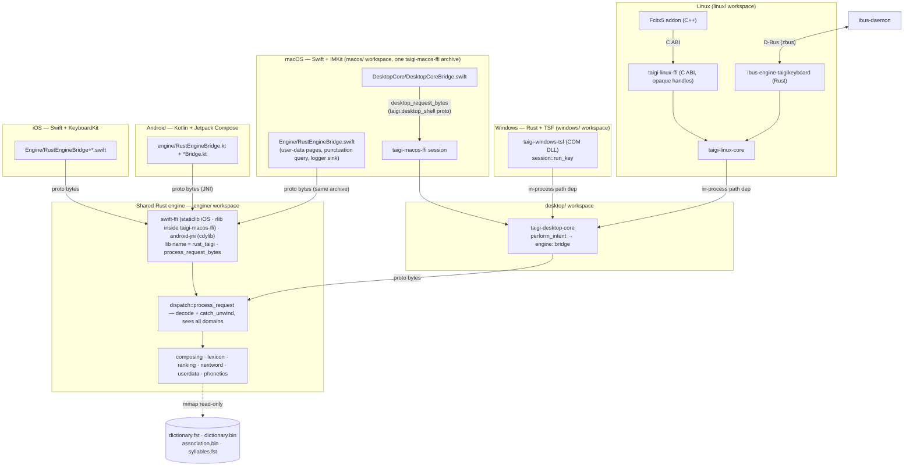
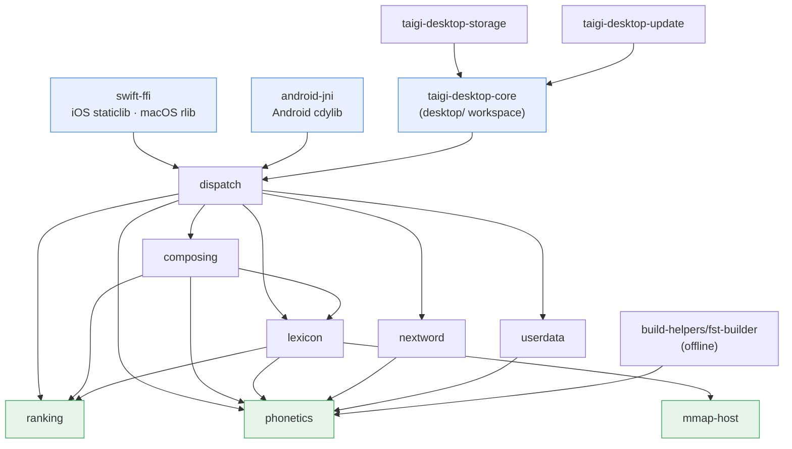
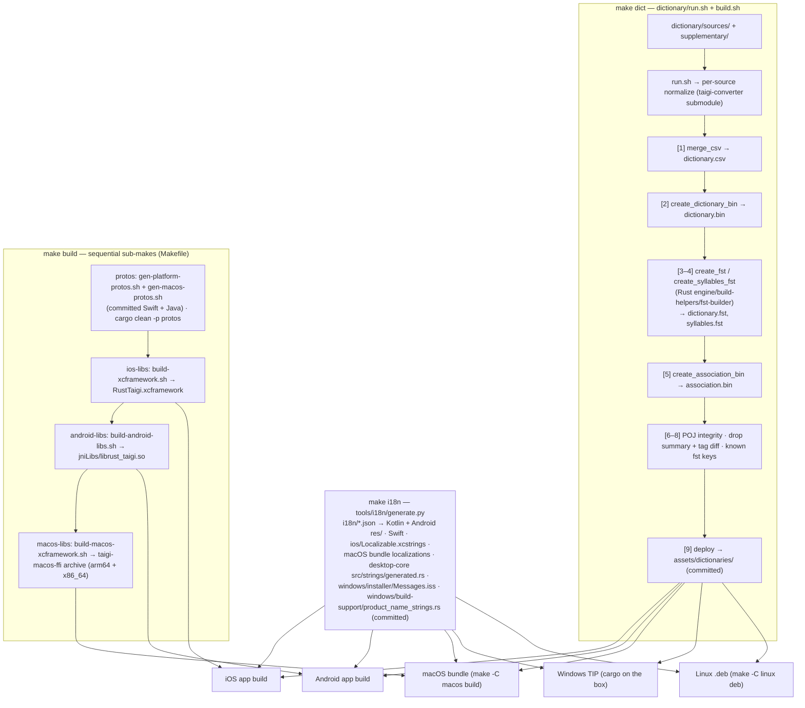
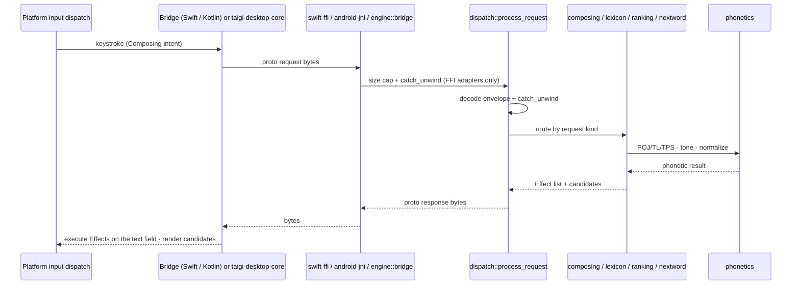

# System Overview (Architecture Diagrams)

> **Type**: Reference — the "read first for architecture" entry point (`AGENTS.md`)
> **Keywords**: `architecture`, `diagram`, `engine`, `FFI`, `build-pipeline`, `data-flow`, `five platforms`
> **Related**: data-artifacts-portability.md, build-artifacts.md, ../engine/rust-core-proto.md, ../contributing/rust-ffi-safety.md

---

## Summary

- Five thin platform shells over one shared Rust engine (`engine/` Cargo workspace). Every path ends in `dispatch::process_request`; proto envelope bytes exist only at that boundary. **iOS** (Swift + KeyboardKit) and **Android** (Kotlin + Jetpack Compose) cross an FFI seam with proto bytes; **macOS** (Swift, InputMethodKit) runs its key path in `taigi-desktop-core` through one static library from its own `macos/` workspace (`taigi-macos-ffi`), plus a `swift-ffi` side channel in the same archive; **Windows** (Rust, Text Services Framework, `windows/` workspace) and **Linux** (Fcitx5 addon in C++ over a Rust C ABI + IBus engine in Rust, GTK 4 / libadwaita settings, `linux/` workspace) link `taigi-desktop-core` and `dispatch` in-process by path — no engine FFI.
- Two release trains: mobile (iOS + Android, `mobile-x.y.z`) and desktop (macOS + Windows + Linux, `desktop-x.y.z`). Diagrams are drawn from actual code (crate manifests, `Makefile`, build scripts) — keep them in sync when those change.

---

## 1. System context

The mobile shells and the macOS side channel marshal a proto request to `process_request_bytes`; the desktop key paths call `taigi-desktop-core`, whose `engine::bridge` encodes the same envelope for `dispatch`. The four read-only data artifacts (`assets/dictionaries/`, committed) are byte-identical across platforms and memory-mapped by the engine.

User-writable state is four SQLite files, **owned by the engine crate `userdata`** on every platform (`rusqlite`): `user_frequency.db` (schema v2), `user_association.db` (v6), `custom_dictionary.db` (stamped ≥ 4), `learned_phrases.db` (`behavioral-invariants.md` §50). The platforms name the files and send the picks; the engine reads, ranks and writes. Details: [`data-artifacts-portability.md`](data-artifacts-portability.md) §4–8. Settings: iOS / Android keep their own stores and send `AppConfig` per request; Windows / Linux keep `settings.json` in `taigi-desktop-storage`; macOS keeps UserDefaults and sends a per-request snapshot (`taigi-macos-ffi` `settings.rs`).

| Platform | Shell | Engine hop | Candidate UI | Settings UI | Dogfood gate |
|---|---|---|---|---|---|
| iOS | `ios/` keyboard extension (KeyboardKit `ActionHandler`) + host app | `RustEngineBridge+<Area>.swift` → `process_request_bytes` (`swift-ffi` staticlib in `RustTaigi.xcframework`) → `dispatch` | KeyboardKit smartbar + overlays | SwiftUI tabs | Xcode → simulator (`AGENTS.md` § Build & Test) |
| Android | `android/` `TaigiKeyboard : LifecycleInputMethodService` (Kotlin + Jetpack Compose) | `RustEngineBridge.kt` + `<Area>Bridge.kt` → JNI `processRequestBytes` (`android-jni` cdylib) → `dispatch` | Compose smartbar | Compose activities | `gradlew :app:testDebugUnitTest` |
| macOS | `macos/` SwiftPM `TaigiInputMethodCore` (`TaigiInputController : IMKInputController`) | key path: `DesktopCore/DesktopCoreBridge.swift` → `desktop_request_bytes` (`taigi.desktop_shell` proto) → `taigi-macos-ffi` session → `taigi-desktop-core` `perform_intent` → `engine::bridge` → `dispatch`; side channel: `RustEngineBridge` → `process_request_bytes` (`swift-ffi` rlib in the same archive) for user-data pages, `isAttachingPunctuation`, the logger sink | native `NSPanel` candidate window | SwiftUI settings window | `make -C macos test` / `install` |
| Windows | `windows/crates/taigi-windows-tsf` (COM DLL) over `taigi-desktop-core` / `taigi-desktop-storage` / `taigi-windows-platform`; settings window `taigi-windows-settings`, updater `taigi-windows-update` are separate crates | `session::run_key` → `taigi-desktop-core` → `dispatch` (in-process path dep, no engine FFI) | DirectWrite candidate window (`tsf/src/ui/`) | WinUI 3 settings window | `make windows-check` (host) + box build (`windows-release.md`) |
| Linux | `linux/fcitx5` (C++ addon) → C ABI `taigi-linux-ffi`; `ibus-engine-taigikeyboard` (`linux/crates/taigikeyboard-ibus`) ⇄ D-Bus (zbus) ⇄ `ibus-daemon`; both over `taigi-linux-core` | `taigi-linux-core` → `taigi-desktop-core` → `dispatch` (in-process path dep; the C ABI carries no proto) | the framework's panel (Fcitx5 input panel / IBus lookup table) | GTK 4 + libadwaita settings window (`taigikeyboard-settings`) | `make linux-check` (host) + `linux-build.yml` (Ubuntu build, ibus smoke, `.deb`; `linux-release.md`) |

---

## 2. Engine crate dependency graph

Canonical crate graph. Thirteen-member Cargo workspace (`engine/Cargo.toml`). Edges point **caller → callee** and flow one way only — the layering rule is `docs/contributing/rust-best-practices.md` §1a. `taigi-desktop-core` (`desktop/` workspace) depends on `dispatch` + `protos` by path and is not an engine member. Every workspace sets `unsafe_code = "forbid"`; only `mmap-host`, the two engine FFI crates, `taigi-windows-tsf`, `taigi-windows-platform`, `taigi-windows-update` and `taigi-linux-ffi` override it in their own manifests (`rust-ffi-safety.md`).

Omitted for readability: **`protos`** (prost-generated message types; the leaf every crate depends on except `ranking`, `mmap-host`, `test-support` and `fst-builder`); external crates (`swift-bridge` / `jni` in the adapters; `fst` in `lexicon`, `fst-builder` and `test-support`; `memmap2` in `mmap-host`; `rusqlite` (bundled SQLite) in `userdata`, which only the `dispatch/user-data` feature pulls in — `taigi-desktop-core` reaches the stores only through `dispatch`'s user-data ops, so a build without that feature stays C-free); **`test-support`** (dev-dependency of `phonetics`, `composing`, `lexicon`, `userdata`, `dispatch`; no engine edge). Layers: **adapters** (`swift-ffi`, `android-jni`, `taigi-desktop-core`) → **use-case** (`dispatch`) → **domain** (`composing`, `lexicon`, `ranking`, `nextword`, `userdata`) → **leaf kernel** (`phonetics`, `protos`, `mmap-host`). `dispatch/src/trace.rs` is the test-build-only JSONL trace behind the `e2e-trace` feature ([`e2e-trace-schema.md`](e2e-trace-schema.md)).

Crates above the graph: `desktop/` = `taigi-desktop-core` (engine bridge, composing coordinator + intent executor, keys, settings model, strings), `taigi-desktop-storage` (settings file + writer, fonts, data directory) and `taigi-desktop-update` (update check, Windows only today); `macos/crates/` = `taigi-macos-ffi` (the one static library the Mac links: `swift-ffi` as an rlib plus the desktop shell seam `desktop_request_bytes` over `taigi-desktop-core`); `windows/crates/` = `taigi-windows-tsf` (COM DLL), `taigi-windows-platform` (Win32 helpers), `taigi-windows-settings` (WinUI 3 window), `taigi-windows-update` (installer download + verify); `linux/crates/` = `taigi-linux-core` (session, executor, chrome), `taigi-linux-platform` (XDG paths, key translation, locale, launcher), `taigi-linux-ffi` (Fcitx5 C ABI), `taigikeyboard-ibus`, `taigikeyboard-settings`. Other trees: `e2e/` (end-to-end scenarios, analyzer, drivers), `emoji/` (own `CLAUDE.md`), `assets/` (dictionaries, fonts, symbols), `windows/installer/`, `linux/packaging/`, `macos/updates/`, `tools/release/stage-desktop.sh`.

---

## 3. Build / artifact pipeline

Three generators feed the platform builds. Committed output: `make dict` (`assets/dictionaries/`), `make i18n`, and the platform proto bindings `make build` regenerates (Java under `android/…/engine/proto`, `.pb.swift` under `ios/` and `macos/`). Gitignored: the xcframeworks and `jniLibs/*.so`. The **stale-artifact gate** (`AGENTS.md` § Build & Test) exists because skipping a producer links the app against old bytes and yields false-green tests. Rationale and timings: [`build-artifacts.md`](build-artifacts.md).

- Windows and Linux need no `make build` step: both compile the engine crates in-process (`windows/Cargo.toml` / `linux/Cargo.toml` path deps). Their host gates are `make windows-check` / `make linux-check` ([`../BUILDING.md`](../BUILDING.md) §4); the Windows DLL builds only on Windows, the `.deb` via `make -C linux deb`.
- `make dict` must finish before `make build` when dictionary sources or syllabifier rules moved; `/release-mobile` and `/release-desktop` rerun `make i18n` + `make build` themselves.

---

## 4. Request data-flow (one keystroke)

Every platform runs the same loop: **input dispatch → composing (engine) → candidate fetch (engine) → display → selection → commit + learning**. The engine owns the state machine, the ranking and the user's data; the platform owns the text-field binding, the candidate surface and the timers.

`dispatch::process_request` (`engine/dispatch/src/lib.rs`) owns envelope decode and the inner `catch_unwind`; the FFI adapters add the request size cap and a second `catch_unwind`. Entry points: `swift-ffi` `process_request_bytes`, `android-jni` `Java_…_RustEngineBridge_processRequestBytes`, `taigi-macos-ffi` `desktop_request_bytes`; Windows and Linux have no engine FFI. The proto envelope + per-slice request/response shapes are in [`../engine/rust-core-proto.md`](../engine/rust-core-proto.md); panic / size-cap / generation semantics in [`../contributing/rust-ffi-safety.md`](../contributing/rust-ffi-safety.md). Composing state machine contract: [`composing-state-boundary.md`](composing-state-boundary.md); next-word contract: [`nextword-engine-boundary.md`](nextword-engine-boundary.md).

### 4.1 iOS glue chain

| Step | iOS file | Engine crate |
|---|---|---|
| Input dispatch | `Actions/ActionHandler.swift` (+ `+KeyActions`, `+CustomActions`): case conversion by `keyboardCase`; punctuation confirms the composition first; letters / digits enter composing | — |
| Composing wrapper | `Input/Composing/ComposingManager.swift` + `ComposingDelegate.swift` (three-phase apply of the engine `Effect` list onto `UITextDocumentProxy`; `rawInput` / `composingText` snapshot) | `engine/composing` |
| Candidate fetch | `Candidates/Services/TaigiAutocompleteService.swift` — continuous `FetchAtPos` (candidates arrive cased) | `engine/composing` → `engine/lexicon::continuous` (dedup + sort) → `engine/ranking` (score, user weight) |
| Bridge | `Engine/RustEngineBridge.swift` + `RustEngineBridge+{Composing,Lexicon,Phonetics,CaseTransform,NextWord,UserData}.swift`; `UserDataOpening.swift`, `SwiftLoggerSink.swift`, `RustVec+UInt8.swift` | `engine/dispatch` via `engine/swift-ffi` |
| Display | KeyboardKit smartbar; `Candidates/Views/CandidateButtonView.swift`; overlays `Overlays/{Symbol,Settings,Layout}SelectionOverlay.swift`, `ExpandedCandidateOverlay.swift` | — |
| Selection | `Actions/ActionHandler+Suggestions.swift` → `ComposingManager.commitContinuous(…)` → frequency record → NextWord intent | `engine/composing` (`CommitContinuous`) |
| NextWord glue | `NextWord/NextWordController.swift` (timer, `@MainActor`, generation counter; the engine reads and writes `user_association.db` itself) | `engine/nextword` (`decide`, filter) + `engine/dispatch` `PredictNext` (bundled lookup) via `nextwordPredictNext` |
| Settings | `Settings/SharedSettings.swift` + `SettingsKey.swift` (live-read `EngineSettingsProvider`) | `AppConfig` per request |

Engine search ownership on the fetch step: `phonetics::KeyFamily::search_key` (calls `phonetics::normalize_input`) → `lexicon::prefix_index::PrefixIndex` (fst scan) → `lexicon::dictionary_reader::DictionaryReader` + `Filter` (rowid → record, source bitmask) → `ranking::CandidateSortKey` order (`ranking` score + user weight).

### 4.2 Same chain on the other platforms

| Step | Android | macOS | Windows | Linux |
|---|---|---|---|---|
| Input dispatch | `ime/text/TextInputManager.kt`, `CharacterInputPipeline.kt` | `Controller/TaigiInputController.swift` → `Composing/ComposingBackend.swift` → `taigi-macos-ffi` `session.rs` + `key_translation.rs` → the same `perform_intent` | `tsf/src/session.rs::run_key` + `key_translation.rs` → `taigi-desktop-core::composing::perform_intent` (`intent_executor.rs`) | `taigi-linux-core::session` + `taigi-linux-platform::key_translation` → the same `perform_intent` |
| Composing wrapper | `ime/text/composing/ComposingManager.kt` + `ComposingDelegate.kt` (`InputConnection` binding, `composing-state-boundary.md` §11) | `taigi-desktop-core::composing` coordinator over the shell seam; Swift keeps `ComposingSessionCoordinator.swift` (one owner, session tokens) + `ClientWriter.swift` (writes marked / committed text into the IMK client; `TaigiInputController.replay` replays the recorded effects) | `taigi-desktop-core::composing` coordinator + `tsf/src/composition.rs` / `edit_session.rs` | `taigi-desktop-core::composing` coordinator + `taigi-linux-core::executor` (effects replayed as IBus / Fcitx5 signals) |
| Candidate fetch | `ime/text/candidates/TaigiAutocompleteService.kt`; `LexiconService.kt` for the dictionary tab only | same as Windows | `taigi-desktop-core::engine::lexicon` | same as Windows |
| Display | `ime/text/candidates/` (`CandidateStrip.kt`, `CandidateStripState.kt`), `ime/text/overlays/`, `ime/text/smartbar/` (Compose smartbar host) | `Candidates/` (`CandidatePresenter` seam, horizontal / vertical / expandable panels) | `tsf/src/ui/candidate_window.rs`, `candidate_list_element.rs`, `render.rs` | the framework's panel; `taigi-linux-core::selection` pages it |
| Selection | `ime/text/candidates/CandidateClickHandler.kt` | slot keys + Space | slot keys + Space | slot keys + Space |
| NextWord glue | `ime/text/nextword/NextWordController.kt` | same as Windows (write-and-rank, no prediction surface on any desktop) | `taigi-desktop-core::composing::next_word` + `engine::nextword` (the engine records into `user_association.db`) | same as Windows |
| Settings | `ime/settings/PrefHelper.kt` (DataStore) + `ime/settings/EngineSettings.kt` | `Settings/SettingsStore.swift` (UserDefaults); each request carries the key-path settings as a snapshot (`taigi-macos-ffi` `settings.rs`) | `taigi-desktop-core::settings` (`keys.rs`) + `taigi-desktop-storage::settings_file` | same as Windows; paths from `taigi-linux-platform::paths` (XDG) |

State machine on every platform: the engine's `composing::api::Phase` is `Idle` / `Continuous { raw, caret, nailed, conversion }` (`engine/composing/src/api.rs`). Input leaves `Idle`; candidate select / Space / Enter / delete-to-empty return to it; semantics pinned in `behavioral-invariants.md` §13.

### Desktop keyboard layouts

General settings exposes **Keyboard Layout** (`keyboardLayout`: QWERTY default, Dvorak, Colemak) for TL / POJ on macOS and Windows. Layout changes affect subsequent keys, never rewrite existing composing text, and General reset restores QWERTY. TPS always reads keys at QWERTY positions (`SettingsDocument::key_reading_layout`); its picker shows QWERTY, disabled, and leaving TPS restores the stored choice. Number-row / keypad shortcuts keep their positions; character-based bindings and the semicolon candidate key follow the layout.

| Desktop | Behaviour |
|---|---|
| macOS | Stored in UserDefaults; `TaigiInputController` calls `IMKTextInput.overrideKeyboard(withKeyboardNamed:)` on every activation and on a live change, so the OS translates events before the shared key classifier sees them. Nothing layout-related crosses the engine seam. A Dvorak / Colemak input source chosen in System Settings does not configure TaigiKeyboard. |
| Windows | Stored in `settings.json` (`keys::KEYBOARD_LAYOUT`). The TIP runs under the zh-TW US base layout, so `taigi-windows-platform` `layout_remap.rs` remaps keys itself, only while the thread layout is that base (`is_us_base_layout`); remapped keys are marked `is_remapped` and the shared executor writes their text when they would otherwise pass through (Chinese mode only). Global chords and the shortcut recorder follow the layout. Limits: English mode, host shortcuts, password fields and contexts without the TIP stay at QWERTY positions. |
| Linux | No setting: Fcitx5 follows the group layout and the IBus engine declares `<layout>default</layout>`, so both read the system layout's keysyms. |

---

## 5. Where to read next

- Cross-platform contract: `behavioral-invariants.md` · glue shape (layers, DI, live-read settings): `../contributing/ios-architecture.md`, `../contributing/android-guidelines.md`, `../contributing/cross-platform-alignment.md` §2–§3 · composing / next-word bindings: `composing-state-boundary.md`, `nextword-engine-boundary.md`.
- Engine wire: `../engine/rust-core-proto.md`, `../contributing/rust-ffi-safety.md` · desktop design records: `macos-roadmap.md`, `macos-desktop-core-roadmap.md`, `windows-roadmap.md`.
- Releasing: `desktop-release.md` (entry), `macos-release.md`, `windows-release.md`, `manual-release-notes.md` · device acceptance: `dogfood-checklist.md`.
